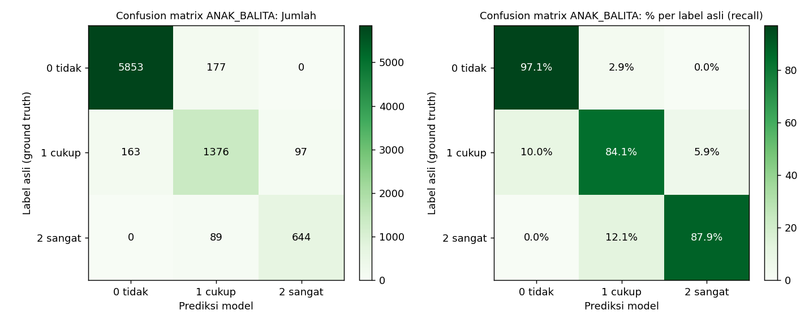
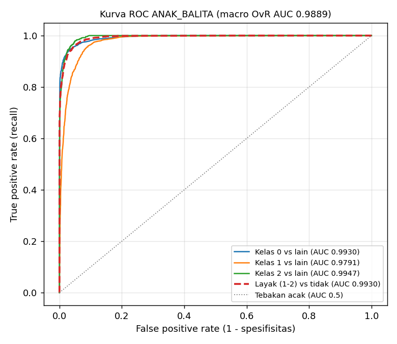

# Laporan Validasi Model ANAK_BALITA

- Pemilik: **Arya**
- Metode: Logistic Regression multinomial (label 0/1/2), metode dan konfigurasi sama dengan 3 kategori lain (config hash `7ec1c77b29e130d2`)
- Data: 560 profil latih (33589 pasangan), 140 profil uji baru (8399 pasangan); split per profil
- Tanggal laporan: 2026-11-03

## 1. Validasi AI (test set profil baru)

Model dievaluasi ulang dari artefak `anak_balita/model/recommender_ANAK_BALITA.joblib` pada `anak_balita/data/test_data.csv`: 8399 pasangan (profil, sesi, makanan) dari 140 profil yang tidak pernah dilihat saat training. Ground truth = kolom `label` (0 tidak sesuai, 1 cukup sesuai, 2 sangat sesuai) dari rubrik pakar; prediksi = kelas dengan `predict_proba` tertinggi; ROC-AUC dihitung dari probabilitas.

Distribusi label test: 0 = 6030 (71.8%), 1 = 1636 (19.5%), 2 = 733 (8.7%). Karena kelas tidak seimbang, accuracy dilengkapi balanced accuracy, metrik macro, dan ROC-AUC.

### 1.1 Ringkasan

| Metrik | Nilai | Arti |
|---|---|---|
| Accuracy | 0.9374 | 7873 dari 8399 pasangan diprediksi tepat |
| Balanced accuracy | 0.8968 | rata-rata recall 3 kelas (tidak bias ke kelas 0) |
| Precision (macro) | 0.8933 | rata-rata precision 3 kelas, bobot sama |
| Recall (macro) | 0.8968 | rata-rata recall 3 kelas, bobot sama |
| F1 (macro) | 0.8950 | rata-rata harmonik precision & recall per kelas |
| Precision / Recall / F1 (weighted) | 0.9376 / 0.9374 / 0.9375 | rata-rata berbobot jumlah data per kelas |
| ROC-AUC macro (one-vs-rest) | 0.9889 | kemampuan memisahkan tiap kelas dari kelas lain, 0.5 = acak, 1 = sempurna |
| ROC-AUC weighted (one-vs-rest) | 0.9904 | sama, dibobot jumlah data per kelas |
| ROC-AUC macro (one-vs-one) | 0.9800 | rata-rata AUC tiap pasang kelas (Hand & Till) |
| ROC-AUC layak (1-2) vs tidak (0) | 0.9930 | skor P(1) + P(2): menu boleh direkomendasikan atau tidak |
| ROC-AUC sangat sesuai (2) vs lainnya | 0.9947 | skor P(2): memilih makanan terbaik |
| Weighted kappa (kuadratik) | 0.9234 | kesepakatan dengan rubrik, salah 0 ke 2 dihukum lebih berat |
| Log loss | 0.1489 | kualitas probabilitas, makin kecil makin baik |
| NDCG@5 / NDCG@10 | 0.9873 / 0.9897 | kualitas urutan ranking menu per sesi |

### 1.2 Definisi metrik

Untuk satu kelas k (one-vs-rest): TP = label k diprediksi k, FP = label lain diprediksi k, FN = label k diprediksi kelas lain.

- Accuracy = jumlah prediksi benar / total data.
- Precision(k) = TP / (TP + FP): dari semua yang diprediksi k, berapa yang benar k.
- Recall(k) = TP / (TP + FN): dari semua yang benar k, berapa yang tertangkap model (sensitivitas).
- F1(k) = 2 x Precision x Recall / (Precision + Recall).
- Macro = rata-rata biasa 3 kelas; weighted = rata-rata berbobot jumlah data (support) tiap kelas.
- Confusion matrix: baris = label asli, kolom = prediksi; diagonal = prediksi benar.
- ROC-AUC: luas di bawah kurva TPR (recall) terhadap FPR untuk semua ambang probabilitas. Nilai = peluang model memberi skor lebih tinggi pada contoh positif acak daripada contoh negatif acak.

### 1.3 Precision, recall, F1 per kelas

| Kelas | Precision | Recall | F1 | ROC-AUC (OvR) | Jumlah (support) |
|---|---|---|---|---|---|
| 0 tidak sesuai | 0.9729 | 0.9706 | 0.9718 | 0.9930 | 6030 |
| 1 cukup sesuai | 0.8380 | 0.8411 | 0.8395 | 0.9791 | 1636 |
| 2 sangat sesuai | 0.8691 | 0.8786 | 0.8738 | 0.9947 | 733 |
| **Macro avg** | 0.8933 | 0.8968 | 0.8950 | 0.9889 | 8399 |
| **Weighted avg** | 0.9376 | 0.9374 | 0.9375 | 0.9904 | 8399 |

- Kelas 0 (tidak sesuai): precision 0.9729 berarti makanan yang ditolak model memang hampir selalu tidak sesuai menurut rubrik; recall 0.9706 berarti hampir semua makanan tidak sesuai berhasil ditolak.
- Kelas 2 (sangat sesuai): precision 0.8691, recall 0.8786. Recall setara atau lebih tinggi dari precision.

### 1.4 Confusion matrix

Jumlah pasangan (baris = label asli, kolom = prediksi):

| Asli \ Prediksi | 0 tidak sesuai | 1 cukup sesuai | 2 sangat sesuai | Total |
|---|---|---|---|---|
| 0 tidak sesuai | 5853 | 177 | 0 | 6030 |
| 1 cukup sesuai | 163 | 1376 | 97 | 1636 |
| 2 sangat sesuai | 0 | 89 | 644 | 733 |

Persen per baris (diagonal = recall kelas tersebut):

| Asli \ Prediksi | 0 tidak sesuai | 1 cukup sesuai | 2 sangat sesuai |
|---|---|---|---|
| 0 tidak sesuai | 97.06% | 2.94% | 0.00% |
| 1 cukup sesuai | 9.96% | 84.11% | 5.93% |
| 2 sangat sesuai | 0.00% | 12.14% | 87.86% |

- Benar: 7873 (93.74%). Salah ke kelas bersebelahan (0-1 atau 1-2): 526 (6.26%).
- Salah ekstrem (0 diprediksi 2 atau 2 diprediksi 0): 0 (0.00%). Kesalahan ekstrem paling berbahaya untuk rekomendasi; nilai kecil berarti model jarang membalik penilaian.

### 1.5 ROC-AUC

| Sudut pandang | Positif | Skor | ROC-AUC |
|---|---|---|---|
| Kelas 0 vs lainnya | label 0 | P(0) | 0.9930 |
| Kelas 1 vs lainnya | label 1 | P(1) | 0.9791 |
| Kelas 2 vs lainnya | label 2 | P(2) | 0.9947 |
| Macro one-vs-rest | - | - | 0.9889 |
| Weighted one-vs-rest | - | - | 0.9904 |
| Macro one-vs-one | - | - | 0.9800 |
| Layak vs tidak | label 1 atau 2 | P(1) + P(2) | 0.9930 |
| Sangat sesuai vs lainnya | label 2 | P(2) | 0.9947 |

- Kelas 1 (cukup sesuai) berada di tengah skala ordinal sehingga paling sulit dipisahkan; AUC-nya wajar paling rendah.
- AUC 'layak vs tidak' paling relevan untuk keamanan produk: seberapa baik model memisahkan makanan yang boleh direkomendasikan dari yang tidak, sebelum filter keamanan (alergi, pantangan, BLOKIR) diterapkan di produksi.

### 1.6 Validasi silang GroupKFold (5 lipatan, data latih)

Profil di lipatan validasi tidak pernah ada di lipatan latih. Simpangan baku kecil = performa stabil antar subset profil.

| Metrik | Rata-rata | Simpangan baku |
|---|---|---|
| accuracy | 0.9317 | 0.0034 |
| macro_f1 | 0.8867 | 0.0066 |
| weighted_kappa | 0.9154 | 0.0042 |
| ndcg@5 | 0.9855 | 0.0010 |

Precision, recall, dan ROC-AUC per lipatan ikut tercatat setelah model dilatih ulang (`python anak_balita/ai_models/latih_anak_balita.py`).

### 1.7 Generalisasi ke makanan baru

15% makanan hanya muncul di test (tidak pernah dilihat model saat training):

| Subset | Jumlah | Accuracy | Precision (macro) | Recall (macro) | F1 (macro) | ROC-AUC macro OvR |
|---|---|---|---|---|---|---|
| Seluruh test | 8399 | 0.9374 | 0.8933 | 0.8968 | 0.8950 | 0.9889 |
| Makanan baru | 1331 | 0.9376 | 0.8935 | 0.8935 | 0.8935 | 0.9894 |

## 2. Pembanding

| Metode | Accuracy | F1 (macro) | Kappa | NDCG@5 |
|---|---|---|---|---|
| Logistic Regression (model) | 0.9374 | 0.8950 | 0.9234 | 0.9873 |
| Gradient boosting (pembanding) | 0.9615 | 0.9325 | 0.9530 | 0.9931 |
| Formula lama | - | - | - | 0.6819 |
| Urutan acak | - | - | - | 0.5041 |

- Pasangan konflik yang tetap diberi label > 0 oleh model saja: 0.00% (di produksi dibuang dulu oleh filter keamanan)

## 3. Koefisien teratas (arah sangat sesuai vs tidak sesuai)

| Fitur | Bobot |
|---|---|
| natrium_lewat_jauh | -8.4174 |
| fat_share | -7.9305 |
| gula_lewat_jauh | -7.835 |
| porsi_wajar | 6.9483 |
| any_conflict | -6.7686 |
| n_block_kategori | -4.5104 |
| ft_protein__snack | -4.1791 |
| porsi_ideal | 3.7658 |
| protein_pct_sesuai | 3.3556 |
| n_conflict_pantangan | -2.5978 |

## 4. Uji end-to-end (filter keamanan + model + penyusun menu, katalog Supabase)

| Skenario | Item | Kandidat lolos | Alergen | BLOKIR | Tekstur | Skor rata-rata | Latensi (ms) |
|---|---|---|---|---|---|---|---|
| Anak Balita Underweight | 11 | 40 | 0 | 0 | 0 | 75.4 | 39.4 |
| Balita 18 Bulan Tanpa HAZ/WHZ | 11 | 42 | 0 | 0 | 0 | 77.0 | 37.4 |

**Anak Balita Underweight**: pagi: karbo: Quinoa, lauk: Lentils, buah/sayur: Red Chili; snack_pagi: selingan: Strawberry Yogurt; siang: karbo: Organic Brown Rice, lauk: Fresh Chicken Breast, sayur: Sweet Potato; snack_sore: selingan: Oranges; malam: karbo: Oatmeal, lauk: Edamame, sayur: Red Onion

**Balita 18 Bulan Tanpa HAZ/WHZ**: pagi: karbo: Quinoa, lauk: Lentils, buah/sayur: Oranges; snack_pagi: selingan: Greek Yogurt; siang: karbo: Whole Wheat Bread, lauk: Tilapia Fish, sayur: Red Chili; snack_sore: selingan: Strawberry Yogurt; malam: karbo: Organic Brown Rice, lauk: Tofu, sayur: Red Onion

## 5. Catatan

Data sintetis dan label dari rubrik kategori (anak_balita/ai_models/rubrik.py). Angka di atas mengukur seberapa baik model meniru rubrik, bukan hasil uji klinis. Diperlukan gold set ahli gizi (minimal 300 pasangan) sebelum klaim klinis.
