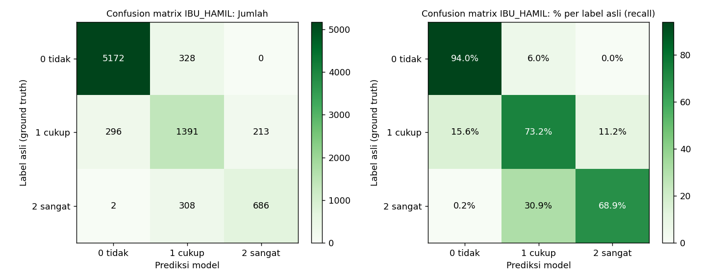
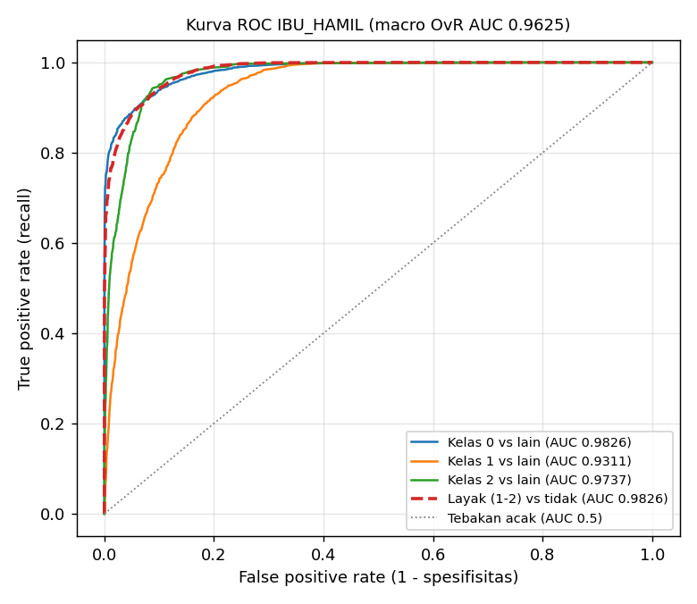

# Laporan Validasi Model IBU_HAMIL

- Pemilik: **Muz**
- Metode: Logistic Regression multinomial (label 0/1/2), metode dan konfigurasi sama dengan 3 kategori lain (config hash `7ec1c77b29e130d2`)
- Data: 560 profil latih (33586 pasangan), 140 profil uji baru (8396 pasangan); split per profil
- Tanggal laporan: 2026-11-03

## 1. Validasi AI (test set profil baru)

Model dievaluasi ulang dari artefak `ibu_hamil/model/recommender_IBU_HAMIL.joblib` pada `ibu_hamil/data/test_data.csv`: 8396 pasangan (profil, sesi, makanan) dari 140 profil yang tidak pernah dilihat saat training. Ground truth = kolom `label` (0 tidak sesuai, 1 cukup sesuai, 2 sangat sesuai) dari rubrik pakar; prediksi = kelas dengan `predict_proba` tertinggi; ROC-AUC dihitung dari probabilitas.

Distribusi label test: 0 = 5500 (65.5%), 1 = 1900 (22.6%), 2 = 996 (11.9%). Karena kelas tidak seimbang, accuracy dilengkapi balanced accuracy, metrik macro, dan ROC-AUC.

### 1.1 Ringkasan

| Metrik | Nilai | Arti |
|---|---|---|
| Accuracy | 0.8634 | 7249 dari 8396 pasangan diprediksi tepat |
| Balanced accuracy | 0.7871 | rata-rata recall 3 kelas (tidak bias ke kelas 0) |
| Precision (macro) | 0.7983 | rata-rata precision 3 kelas, bobot sama |
| Recall (macro) | 0.7871 | rata-rata recall 3 kelas, bobot sama |
| F1 (macro) | 0.7918 | rata-rata harmonik precision & recall per kelas |
| Precision / Recall / F1 (weighted) | 0.8652 / 0.8634 / 0.8639 | rata-rata berbobot jumlah data per kelas |
| ROC-AUC macro (one-vs-rest) | 0.9625 | kemampuan memisahkan tiap kelas dari kelas lain, 0.5 = acak, 1 = sempurna |
| ROC-AUC weighted (one-vs-rest) | 0.9699 | sama, dibobot jumlah data per kelas |
| ROC-AUC macro (one-vs-one) | 0.9371 | rata-rata AUC tiap pasang kelas (Hand & Till) |
| ROC-AUC layak (1-2) vs tidak (0) | 0.9826 | skor P(1) + P(2): menu boleh direkomendasikan atau tidak |
| ROC-AUC sangat sesuai (2) vs lainnya | 0.9737 | skor P(2): memilih makanan terbaik |
| Weighted kappa (kuadratik) | 0.8552 | kesepakatan dengan rubrik, salah 0 ke 2 dihukum lebih berat |
| Log loss | 0.2881 | kualitas probabilitas, makin kecil makin baik |
| NDCG@5 / NDCG@10 | 0.9560 / 0.9672 | kualitas urutan ranking menu per sesi |

### 1.2 Definisi metrik

Untuk satu kelas k (one-vs-rest): TP = label k diprediksi k, FP = label lain diprediksi k, FN = label k diprediksi kelas lain.

- Accuracy = jumlah prediksi benar / total data.
- Precision(k) = TP / (TP + FP): dari semua yang diprediksi k, berapa yang benar k.
- Recall(k) = TP / (TP + FN): dari semua yang benar k, berapa yang tertangkap model (sensitivitas).
- F1(k) = 2 x Precision x Recall / (Precision + Recall).
- Macro = rata-rata biasa 3 kelas; weighted = rata-rata berbobot jumlah data (support) tiap kelas.
- Confusion matrix: baris = label asli, kolom = prediksi; diagonal = prediksi benar.
- ROC-AUC: luas di bawah kurva TPR (recall) terhadap FPR untuk semua ambang probabilitas. Nilai = peluang model memberi skor lebih tinggi pada contoh positif acak daripada contoh negatif acak.

### 1.3 Precision, recall, F1 per kelas

| Kelas | Precision | Recall | F1 | ROC-AUC (OvR) | Jumlah (support) |
|---|---|---|---|---|---|
| 0 tidak sesuai | 0.9455 | 0.9404 | 0.9429 | 0.9826 | 5500 |
| 1 cukup sesuai | 0.6862 | 0.7321 | 0.7084 | 0.9311 | 1900 |
| 2 sangat sesuai | 0.7631 | 0.6888 | 0.7240 | 0.9737 | 996 |
| **Macro avg** | 0.7983 | 0.7871 | 0.7918 | 0.9625 | 8396 |
| **Weighted avg** | 0.8652 | 0.8634 | 0.8639 | 0.9699 | 8396 |

- Kelas 0 (tidak sesuai): precision 0.9455 berarti makanan yang ditolak model memang hampir selalu tidak sesuai menurut rubrik; recall 0.9404 berarti hampir semua makanan tidak sesuai berhasil ditolak.
- Kelas 2 (sangat sesuai): precision 0.7631, recall 0.6888. Recall lebih rendah dari precision: model cenderung hati-hati, sebagian makanan terbaik dinilai 'cukup sesuai'.

### 1.4 Confusion matrix

Jumlah pasangan (baris = label asli, kolom = prediksi):

| Asli \ Prediksi | 0 tidak sesuai | 1 cukup sesuai | 2 sangat sesuai | Total |
|---|---|---|---|---|
| 0 tidak sesuai | 5172 | 328 | 0 | 5500 |
| 1 cukup sesuai | 296 | 1391 | 213 | 1900 |
| 2 sangat sesuai | 2 | 308 | 686 | 996 |

Persen per baris (diagonal = recall kelas tersebut):

| Asli \ Prediksi | 0 tidak sesuai | 1 cukup sesuai | 2 sangat sesuai |
|---|---|---|---|
| 0 tidak sesuai | 94.04% | 5.96% | 0.00% |
| 1 cukup sesuai | 15.58% | 73.21% | 11.21% |
| 2 sangat sesuai | 0.20% | 30.92% | 68.88% |

- Benar: 7249 (86.34%). Salah ke kelas bersebelahan (0-1 atau 1-2): 1145 (13.64%).
- Salah ekstrem (0 diprediksi 2 atau 2 diprediksi 0): 2 (0.02%). Kesalahan ekstrem paling berbahaya untuk rekomendasi; nilai kecil berarti model jarang membalik penilaian.

### 1.5 ROC-AUC

| Sudut pandang | Positif | Skor | ROC-AUC |
|---|---|---|---|
| Kelas 0 vs lainnya | label 0 | P(0) | 0.9826 |
| Kelas 1 vs lainnya | label 1 | P(1) | 0.9311 |
| Kelas 2 vs lainnya | label 2 | P(2) | 0.9737 |
| Macro one-vs-rest | - | - | 0.9625 |
| Weighted one-vs-rest | - | - | 0.9699 |
| Macro one-vs-one | - | - | 0.9371 |
| Layak vs tidak | label 1 atau 2 | P(1) + P(2) | 0.9826 |
| Sangat sesuai vs lainnya | label 2 | P(2) | 0.9737 |

- Kelas 1 (cukup sesuai) berada di tengah skala ordinal sehingga paling sulit dipisahkan; AUC-nya wajar paling rendah.
- AUC 'layak vs tidak' paling relevan untuk keamanan produk: seberapa baik model memisahkan makanan yang boleh direkomendasikan dari yang tidak, sebelum filter keamanan (alergi, pantangan, BLOKIR) diterapkan di produksi.

### 1.6 Validasi silang GroupKFold (5 lipatan, data latih)

Profil di lipatan validasi tidak pernah ada di lipatan latih. Simpangan baku kecil = performa stabil antar subset profil.

| Metrik | Rata-rata | Simpangan baku |
|---|---|---|
| accuracy | 0.8681 | 0.0057 |
| macro_f1 | 0.7970 | 0.0070 |
| weighted_kappa | 0.8612 | 0.0048 |
| ndcg@5 | 0.9579 | 0.0044 |

Precision, recall, dan ROC-AUC per lipatan ikut tercatat setelah model dilatih ulang (`python ibu_hamil/ai_models/latih_ibu_hamil.py`).

### 1.7 Generalisasi ke makanan baru

15% makanan hanya muncul di test (tidak pernah dilihat model saat training):

| Subset | Jumlah | Accuracy | Precision (macro) | Recall (macro) | F1 (macro) | ROC-AUC macro OvR |
|---|---|---|---|---|---|---|
| Seluruh test | 8396 | 0.8634 | 0.7983 | 0.7871 | 0.7918 | 0.9625 |
| Makanan baru | 1263 | 0.8543 | 0.7926 | 0.7750 | 0.7822 | 0.9607 |

## 2. Pembanding

| Metode | Accuracy | F1 (macro) | Kappa | NDCG@5 |
|---|---|---|---|---|
| Logistic Regression (model) | 0.8634 | 0.7918 | 0.8552 | 0.9560 |
| Gradient boosting (pembanding) | 0.9204 | 0.8766 | 0.9142 | 0.9765 |
| Formula lama | - | - | - | 0.6614 |
| Urutan acak | - | - | - | 0.5360 |

- Pasangan konflik yang tetap diberi label > 0 oleh model saja: 0.00% (di produksi dibuang dulu oleh filter keamanan)

## 3. Koefisien teratas (arah sangat sesuai vs tidak sesuai)

| Fitur | Bobot |
|---|---|
| fat_share | -4.6453 |
| any_conflict | -4.5357 |
| gula_lewat_jauh | -4.4477 |
| natrium_lewat_jauh | -4.3371 |
| porsi_wajar | 3.2051 |
| n_block_kategori | -2.7776 |
| porsi_ideal | 2.3452 |
| energy_density | 2.2418 |
| ft_protein__snack | -2.1208 |
| n_conflict_allergen | -2.04 |

## 4. Uji end-to-end (filter keamanan + model + penyusun menu, katalog Supabase)

| Skenario | Item | Kandidat lolos | Alergen | BLOKIR | Tekstur | Skor rata-rata | Latensi (ms) |
|---|---|---|---|---|---|---|---|
| Ibu Hamil T3 | 11 | 43 | 0 | 0 | 0 | 71.1 | 38.4 |
| Ibu Hamil T1 Alergi Susu | 11 | 41 | 0 | 0 | 0 | 75.6 | 37.2 |

**Ibu Hamil T3**: pagi: karbo: Oatmeal, lauk: Mung Beans, buah/sayur: Banana; snack_pagi: selingan: Baked Potato Chips; siang: karbo: Whole Wheat Bread, lauk: Fresh Chicken Breast, sayur: Sweet Potato; snack_sore: selingan: Ajwa Dates; malam: karbo: Quinoa, lauk: Lentils, sayur: Red Chili

**Ibu Hamil T1 Alergi Susu**: pagi: karbo: Oatmeal, lauk: Tilapia Fish, buah/sayur: Banana; snack_pagi: selingan: Baked Potato Chips; siang: karbo: Quinoa, lauk: Fresh Chicken Breast, sayur: Sweet Potato; snack_sore: selingan: Ajwa Dates; malam: karbo: Whole Wheat Bread, lauk: Mung Beans, sayur: Red Chili

## 5. Catatan

Data sintetis dan label dari rubrik kategori (ibu_hamil/ai_models/rubrik.py). Angka di atas mengukur seberapa baik model meniru rubrik, bukan hasil uji klinis. Diperlukan gold set ahli gizi (minimal 300 pasangan) sebelum klaim klinis.
