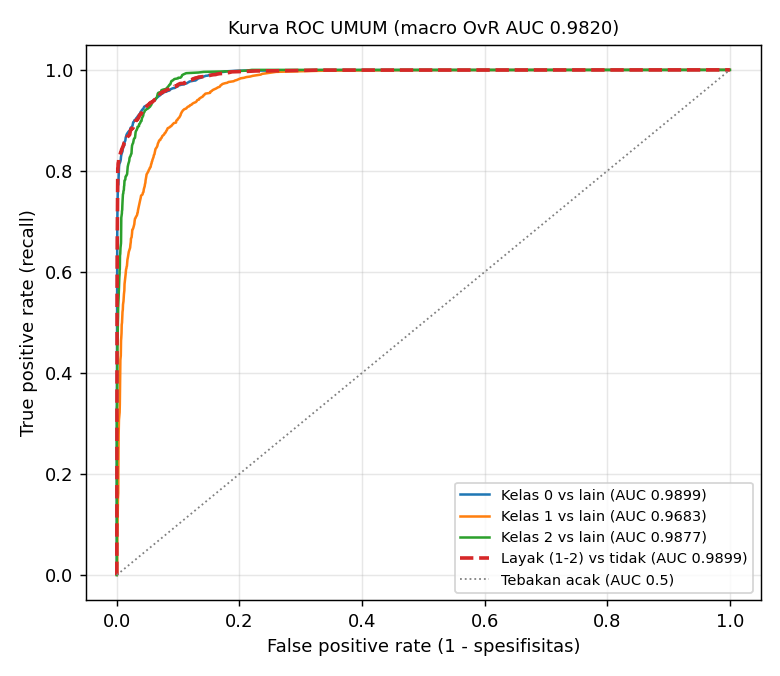
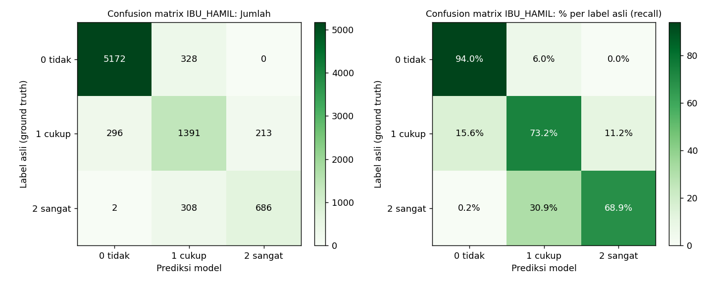
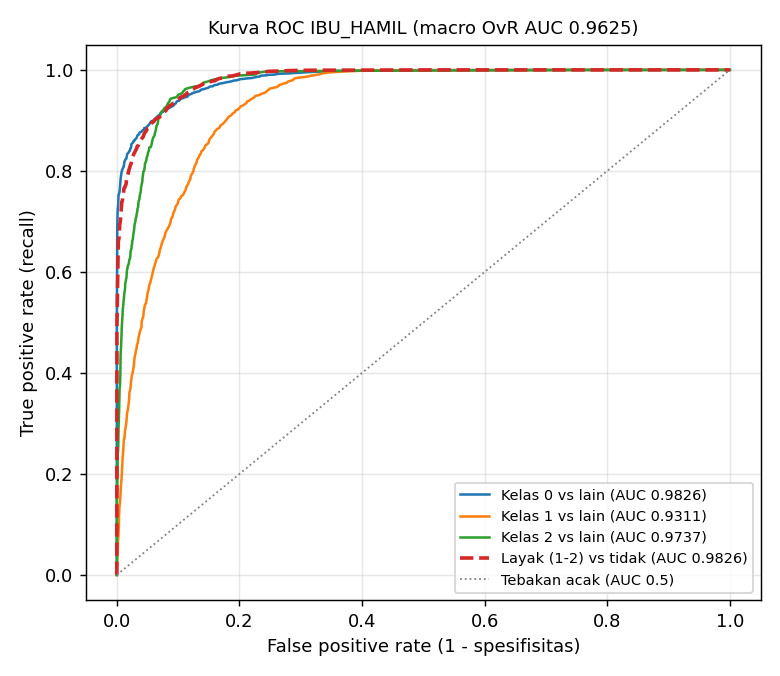
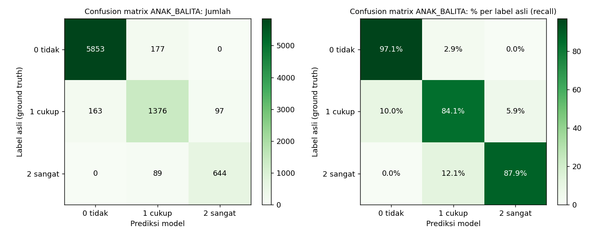
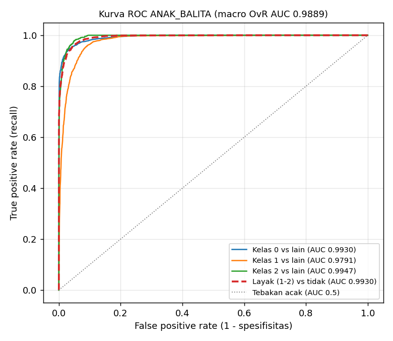
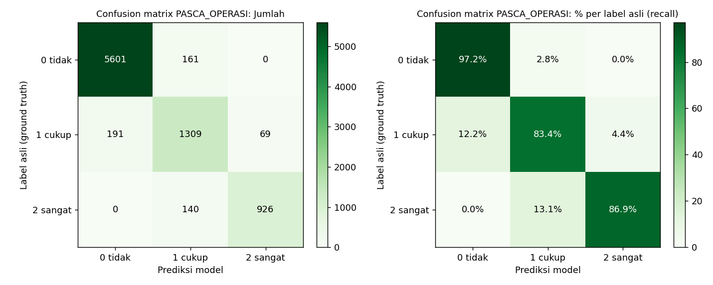
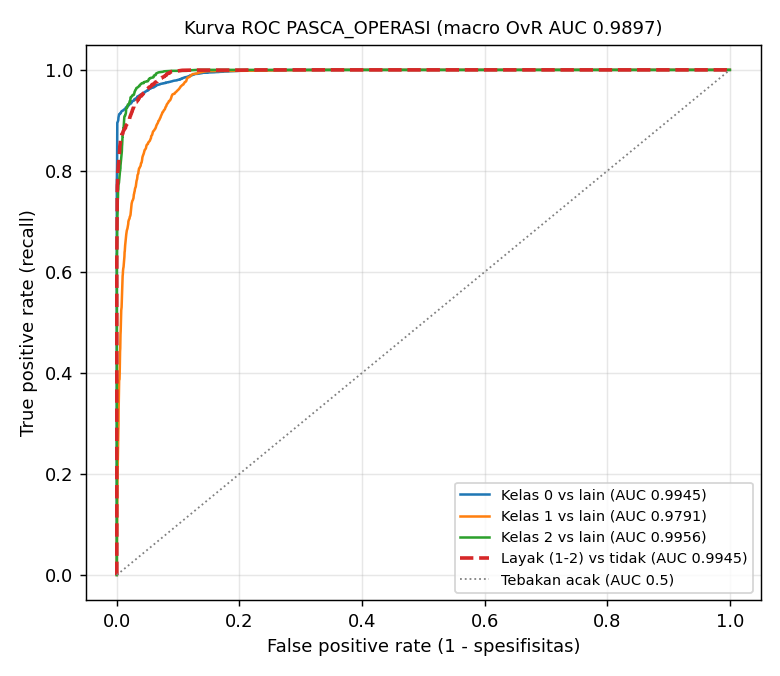

# Laporan Validasi AI NutriScale

Tanggal laporan: 2026-11-03. Laporan ini dibuat dengan perintah `python validasi_ai.py`.

## 1. Pendahuluan

Sistem rekomendasi NutriScale memakai empat model Logistic Regression multinomial, satu model untuk setiap kategori pengguna, yaitu UMUM, IBU_HAMIL, ANAK_BALITA, dan PASCA_OPERASI. Setiap model menilai kesesuaian satu makanan untuk satu pengguna pada satu sesi makan dengan tiga kelas: 0 (tidak sesuai), 1 (cukup sesuai), dan 2 (sangat sesuai). Validasi ini bertujuan mengukur seberapa baik model memberi penilaian tersebut pada data yang belum pernah dilihat saat pelatihan.

Data uji yang dipakai adalah test set setiap kategori (`<kategori>/data/test_data.csv`) dengan total 33590 pasangan (profil, sesi, makanan). Pembagian data dilakukan berdasarkan profil, sehingga profil pada data uji tidak pernah muncul pada data latih. Ground truth diambil dari kolom `label` yang dihitung oleh rubrik pada `shared/dataset.py` dan `<kategori>/ai_models/rubrik.py`. Makanan yang bertentangan dengan alergi, pantangan, atau daftar BLOKIR selalu diberi label 0. Prediksi model adalah kelas dengan probabilitas tertinggi dari `predict_proba`.

## 2. Metrik Evaluasi

### 2.1 Metrik utama

Metrik utama yang dipakai adalah weighted kappa kuadratik dan NDCG@k. Pemilihan ini didasarkan pada tiga alasan.

Pertama, label bersifat ordinal, artinya label 0, 1, dan 2 memiliki urutan. Accuracy, precision, dan recall menganggap semua kesalahan sama. Salah memprediksi label 1 sebagai 2 dihitung sama dengan salah memprediksi label 0 sebagai 2, padahal kesalahan kedua lebih berbahaya karena makanan yang tidak sesuai dianggap sangat sesuai. Weighted kappa kuadratik memberi bobot berdasarkan kuadrat jarak antar kelas, sehingga kesalahan sejauh dua tingkat diberi bobot empat kali lebih besar daripada kesalahan satu tingkat.

Kedua, jumlah data setiap kelas tidak seimbang. Sekitar dua pertiga label bernilai 0, sehingga model yang selalu menjawab 0 sudah memperoleh accuracy yang cukup tinggi. Weighted kappa memperhitungkan kesepakatan yang dapat terjadi secara kebetulan, sehingga model seperti itu hanya mendapat nilai kappa 0.

Ketiga, aplikasi memakai model untuk mengurutkan makanan, bukan hanya untuk mengelompokkan. Pada setiap sesi makan, kandidat makanan diurutkan dengan skor (P(1) + 2 x P(2)) / 2, lalu makanan teratas dipilih untuk menu. NDCG@k menilai kualitas urutan tersebut. Makanan berlabel 2 memberi nilai lebih besar daripada makanan berlabel 1, dan kesalahan pada urutan teratas berpengaruh lebih besar daripada kesalahan pada urutan bawah.

### 2.2 Metrik pendukung

Accuracy, precision, recall, F1, confusion matrix, dan ROC-AUC tetap dilaporkan karena metrik ini umum dipakai dan berguna untuk melihat performa setiap kelas. Precision kelas k adalah proporsi prediksi kelas k yang benar, sedangkan recall kelas k adalah proporsi data kelas k yang berhasil dikenali model. Nilai macro adalah rata-rata ketiga kelas dengan bobot yang sama. ROC-AUC dihitung dari probabilitas dengan pendekatan one-vs-rest, yaitu satu kelas dibandingkan dengan dua kelas lainnya. Nilai 0.5 setara dengan tebakan acak dan nilai 1 berarti pemisahan sempurna. Rumus lengkap setiap metrik dapat dilihat pada laporan per kategori.

## 3. Hasil Validasi

### 3.1 Metrik utama

Tabel 1. Weighted kappa dan NDCG@5 setiap model

| Model | Weighted kappa | NDCG@5 model | NDCG@5 formula lama | NDCG@5 urutan acak | Accuracy model | Accuracy jika selalu menjawab 0 |
|---|---|---|---|---|---|---|
| UMUM | 0.8939 | 0.9799 | 0.6850 | 0.5406 | 0.9127 | 0.6649 |
| IBU_HAMIL | 0.8552 | 0.9560 | 0.6614 | 0.5360 | 0.8634 | 0.6551 |
| ANAK_BALITA | 0.9234 | 0.9873 | 0.6819 | 0.5041 | 0.9374 | 0.7179 |
| PASCA_OPERASI | 0.9320 | 0.9899 | 0.7416 | 0.6149 | 0.9332 | 0.6862 |

Berdasarkan Tabel 1, weighted kappa keempat model berada di antara 0.8552 (IBU_HAMIL) dan 0.9320 (PASCA_OPERASI). NDCG@5 model pada semua kategori lebih tinggi daripada formula lama dan urutan acak. Sebagai contoh, pada kategori UMUM NDCG@5 model adalah 0.9799, sedangkan formula lama hanya 0.6850 dan urutan acak 0.5406. Kolom terakhir menunjukkan bahwa accuracy saja kurang tepat untuk menilai model, karena menjawab 0 untuk semua data sudah menghasilkan accuracy 0.66 sampai 0.72.

### 3.2 Metrik pendukung

Tabel 2. Ringkasan metrik pendukung setiap model

| Model | Pemilik | Data uji | Accuracy | Balanced accuracy | Precision (macro) | Recall (macro) | F1 (macro) | ROC-AUC (macro OvR) |
|---|---|---|---|---|---|---|---|---|
| UMUM | Muel | 8398 | 0.9127 | 0.8589 | 0.8755 | 0.8589 | 0.8665 | 0.9820 |
| IBU_HAMIL | Muz | 8396 | 0.8634 | 0.7871 | 0.7983 | 0.7871 | 0.7918 | 0.9625 |
| ANAK_BALITA | Arya | 8399 | 0.9374 | 0.8968 | 0.8933 | 0.8968 | 0.8950 | 0.9889 |
| PASCA_OPERASI | Raymond | 8397 | 0.9332 | 0.8917 | 0.9036 | 0.8917 | 0.8972 | 0.9897 |

Rata-rata keempat model adalah accuracy 0.9117, precision macro 0.8677, recall macro 0.8586, F1 macro 0.8626, dan ROC-AUC macro 0.9808.

### 3.3 ROC-AUC

Tabel 3. ROC-AUC setiap model

| Model | Kelas 0 vs lain | Kelas 1 vs lain | Kelas 2 vs lain | Macro OvR | Weighted OvR | Macro OvO | Layak vs tidak | Sangat sesuai vs lain |
|---|---|---|---|---|---|---|---|---|
| UMUM | 0.9899 | 0.9683 | 0.9877 | 0.9820 | 0.9845 | 0.9676 | 0.9899 | 0.9877 |
| IBU_HAMIL | 0.9826 | 0.9311 | 0.9737 | 0.9625 | 0.9699 | 0.9371 | 0.9826 | 0.9737 |
| ANAK_BALITA | 0.9930 | 0.9791 | 0.9947 | 0.9889 | 0.9904 | 0.9800 | 0.9930 | 0.9947 |
| PASCA_OPERASI | 0.9945 | 0.9791 | 0.9956 | 0.9897 | 0.9918 | 0.9824 | 0.9945 | 0.9956 |

Kolom layak vs tidak membandingkan label 1 dan 2 dengan label 0 menggunakan skor P(1) + P(2). Kolom ini menunjukkan kemampuan model membedakan makanan yang boleh direkomendasikan dari makanan yang tidak.

### 3.4 Precision, recall, dan pola kesalahan

Tabel 4. Precision dan recall per kelas serta jumlah kesalahan ekstrem

| Model | Kelas 0 (P / R) | Kelas 1 (P / R) | Kelas 2 (P / R) | Prediksi benar | Kesalahan ekstrem (0 dan 2 tertukar) |
|---|---|---|---|---|---|
| UMUM | 0.9576 / 0.9586 | 0.8123 / 0.8369 | 0.8565 / 0.7811 | 7665 (91.27%) | 5 (0.06%) |
| IBU_HAMIL | 0.9455 / 0.9404 | 0.6862 / 0.7321 | 0.7631 / 0.6888 | 7249 (86.34%) | 2 (0.02%) |
| ANAK_BALITA | 0.9729 / 0.9706 | 0.8380 / 0.8411 | 0.8691 / 0.8786 | 7873 (93.74%) | 0 (0.00%) |
| PASCA_OPERASI | 0.9670 / 0.9721 | 0.8130 / 0.8343 | 0.9307 / 0.8687 | 7836 (93.32%) | 0 (0.00%) |

Kesalahan ekstrem adalah label 0 yang diprediksi 2 atau label 2 yang diprediksi 0. Jumlahnya adalah 5 pada UMUM, 2 pada IBU_HAMIL, 0 pada ANAK_BALITA, dan 0 pada PASCA_OPERASI, dari sekitar 8398 data uji per model.

### 3.5 Confusion matrix dan kurva ROC

Tabel 5 dan gambar berikut menunjukkan confusion matrix (baris adalah label asli dan kolom adalah prediksi) serta kurva ROC setiap model.

Tabel 5a. Confusion matrix UMUM

| Asli \ Prediksi | 0 | 1 | 2 |
|---|---|---|---|
| 0 | 5353 | 226 | 5 |
| 1 | 237 | 1709 | 96 |
| 2 | 0 | 169 | 603 |

Gambar 1. Confusion matrix model UMUM

Gambar 2. Kurva ROC model UMUM

Detail model UMUM ada pada [umum/outputs/laporan_validasi_umum.md](umum/outputs/laporan_validasi_umum.md).

Tabel 5b. Confusion matrix IBU_HAMIL

| Asli \ Prediksi | 0 | 1 | 2 |
|---|---|---|---|
| 0 | 5172 | 328 | 0 |
| 1 | 296 | 1391 | 213 |
| 2 | 2 | 308 | 686 |

Gambar 3. Confusion matrix model IBU_HAMIL

Gambar 4. Kurva ROC model IBU_HAMIL

Detail model IBU_HAMIL ada pada [ibu_hamil/outputs/laporan_validasi_ibu_hamil.md](ibu_hamil/outputs/laporan_validasi_ibu_hamil.md).

Tabel 5c. Confusion matrix ANAK_BALITA

| Asli \ Prediksi | 0 | 1 | 2 |
|---|---|---|---|
| 0 | 5853 | 177 | 0 |
| 1 | 163 | 1376 | 97 |
| 2 | 0 | 89 | 644 |

Gambar 5. Confusion matrix model ANAK_BALITA

Gambar 6. Kurva ROC model ANAK_BALITA

Detail model ANAK_BALITA ada pada [anak_balita/outputs/laporan_validasi_anak_balita.md](anak_balita/outputs/laporan_validasi_anak_balita.md).

Tabel 5d. Confusion matrix PASCA_OPERASI

| Asli \ Prediksi | 0 | 1 | 2 |
|---|---|---|---|
| 0 | 5601 | 161 | 0 |
| 1 | 191 | 1309 | 69 |
| 2 | 0 | 140 | 926 |

Gambar 7. Confusion matrix model PASCA_OPERASI

Gambar 8. Kurva ROC model PASCA_OPERASI

Detail model PASCA_OPERASI ada pada [pasca_operasi/outputs/laporan_validasi_pasca_operasi.md](pasca_operasi/outputs/laporan_validasi_pasca_operasi.md).

## 4. Pembahasan

Kelas 1 (cukup sesuai) adalah kelas yang paling sulit dikenali. Hal ini terlihat dari ROC-AUC kelas 1 yang paling rendah pada keempat model serta precision dan recall kelas 1 yang lebih rendah daripada kelas 0. Kondisi ini wajar karena kelas 1 berada di tengah, sehingga sering tertukar dengan kelas 0 maupun kelas 2. Sebagian besar kesalahan model terjadi antara kelas yang bersebelahan, sedangkan kesalahan ekstrem sangat sedikit.

Model IBU_HAMIL memiliki nilai metrik paling rendah. Kemungkinan penyebabnya adalah rubrik IBU_HAMIL paling banyak memakai kolom yang tidak menjadi fitur model, seperti folat, zat besi, dan kafein, serta memberi pengurangan poin lebih besar untuk makanan yang perlu dibatasi. Akibatnya, label pada kategori ini lebih sulit ditiru oleh model linear. Dugaan ini masih perlu dibuktikan, misalnya dengan menambahkan fitur yang berkaitan dengan zat gizi tersebut.

Dari sisi keamanan, model jarang menilai makanan yang tidak sesuai sebagai sangat sesuai. Selain itu, aplikasi tetap menyaring makanan yang bertentangan dengan alergi, pantangan, dan daftar BLOKIR sebelum ranking dilakukan, sehingga keamanan rekomendasi tidak hanya bergantung pada prediksi model.

## 5. Keterbatasan Data dan Ground Truth

Seluruh dataset pada penelitian ini adalah data sintetis. Label yang dijadikan ground truth juga tidak berasal dari ahli gizi, melainkan dihitung oleh rubrik berbasis aturan. Hal ini membawa beberapa keterbatasan yang perlu diperhatikan saat membaca hasil pada Bab 3, seperti dirangkum pada Tabel 6.

Tabel 6. Keterbatasan data dan ground truth

| No | Keterbatasan | Dampak terhadap hasil |
|---|---|---|
| K1 | Label dihasilkan oleh rubrik, bukan dinilai ahli gizi | Weighted kappa 0.86 sampai 0.93 menunjukkan kemampuan model meniru rubrik. Jika ada ambang rubrik yang kurang tepat, model ikut mempelajarinya dan nilai metrik tetap tinggi. |
| K2 | Sebagian fitur model mirip dengan aturan rubrik | Fitur `porsi_ideal`, `porsi_wajar`, `natrium_lewat_jauh`, dan `gula_lewat_jauh` memakai ambang yang sama dengan rubrik, sehingga sebagian akurasi didapat dari menghitung ulang aturan yang sama. Namun rubrik juga memakai kolom yang tidak menjadi fitur (serat, lemak jenuh, vitamin C, folat, zat besi), jadi model tidak sekadar menyalin rubrik. |
| K3 | Label tidak mengandung noise | Rubrik selalu memberi label yang sama untuk input yang sama. Pada data nyata, penilaian antar ahli gizi biasanya tidak selalu sama, sehingga performa model pada data nyata kemungkinan lebih rendah. |
| K4 | Distribusi data ditentukan oleh generator | Sekitar 68% label bernilai 0 karena cara pengambilan kandidat (6 kandidat sesuai sesi, 4 acak, dan 2 kandidat konflik per sesi), bukan karena pola menu sebenarnya. Profil pengguna juga dibuat secara sintetis. |
| K5 | Target kalori data latih berbeda dengan aplikasi | Pada data latih UMUM, profil gemuk dan obesitas diberi target 400 kkal lebih rendah, sedangkan perhitungan NutriScale untuk dewasa tidak memakai pengurangan tersebut. |
| K6 | Katalog makanan berbeda | Model dilatih dengan katalog `data/nutrition.csv` yang berisi 8789 makanan, sedangkan aplikasi memakai katalog produk Supabase yang jauh lebih sedikit. Performa model pada katalog produk belum diuji dengan label. |
| K7 | Label menilai satu makanan, bukan satu hari | Total kalori harian dan kewajaran porsi setelah menu disusun tidak tercakup dalam label maupun metrik. |

Keterbatasan di atas lebih banyak berpengaruh pada ketepatan kecocokan gizi, bukan pada keamanan. Makanan yang bertentangan dengan alergi, pantangan, atau daftar BLOKIR selalu diberi label 0 dan di aplikasi sudah disaring sebelum proses ranking. Pada uji end-to-end tidak ditemukan pelanggaran alergen, BLOKIR, maupun tekstur.

## 6. Rencana Pengembangan

Untuk mengatasi keterbatasan pada Bab 5, disusun lima tahap pengembangan pada Tabel 7. Tahap 1 dan 2 masih dapat dikerjakan dalam lingkup proyek ini, sedangkan tahap 3 sampai 5 memerlukan data pengguna nyata.

Tabel 7. Rencana pengembangan data dan ground truth

| Tahap | Kegiatan | Keluaran | Target | Mengatasi |
|---|---|---|---|---|
| 1. Gold set ahli gizi | Memilih 300 pasangan dari test set secara stratified (100 per label, dari keempat kategori), lalu dua ahli gizi atau dosen gizi memberi label 0/1/2 tanpa melihat label rubrik maupun prediksi model. | Kappa antar penilai, kappa rubrik terhadap ahli, dan kappa model terhadap ahli. | Kappa antar penilai dan kappa rubrik terhadap ahli minimal 0.6. | K1, K3 |
| 2. Revisi rubrik dan uji sensitivitas | Memperbaiki ambang rubrik berdasarkan pasangan yang tidak disepakati ahli. Menguji model dengan ambang rubrik digeser 10 sampai 20 persen dan noise label 5 sampai 10 persen, serta melatih model tanpa fitur yang mirip aturan rubrik. | Perubahan weighted kappa dan NDCG@5 pada setiap skenario. | Penurunan metrik kurang dari 0.05. | K1, K2, K3 |
| 3. Penyesuaian data latih dengan aplikasi | Menyamakan perhitungan target kalori antara generator dan NutriScale, membuat kandidat dari katalog produk Supabase, dan membuat profil yang mendekati data asesmen pengguna (dianonimkan). | Metrik pada test set berbasis katalog produk. | Metrik tidak turun jauh dibanding test set sintetis. | K4, K5, K6 |
| 4. Ground truth dari perilaku pengguna | Mencatat rekomendasi yang dimasukkan ke keranjang, dibeli, atau dilewati pengguna, lalu menjadikannya label tambahan dan mengujinya dengan A/B testing. | NDCG@5 pada data interaksi nyata dan tingkat penambahan ke keranjang. | Model lebih baik daripada formula lama dan urutan acak. | K1, K4, K6 |
| 5. Evaluasi menu harian | Menambah penilaian per hari, yaitu selisih total kalori dan makro terhadap target, kewajaran porsi, dan variasi bahan, yang juga dinilai oleh ahli gizi. | Rata-rata selisih kalori harian dan persentase menu dengan porsi wajar. | Selisih kalori harian dalam 5 persen dari target. | K7 |

Penggunaan data pengguna nyata pada tahap 3 dan 4 hanya dilakukan dengan persetujuan pengguna dan data yang sudah dianonimkan. Model belum dapat diklaim valid secara klinis sebelum tahap 1 menunjukkan kesepakatan yang cukup antara rubrik dan ahli gizi.

## 7. Kesimpulan

Keempat model Logistic Regression mampu meniru penilaian rubrik dengan baik pada data uji, dengan weighted kappa 0.8552 sampai 0.9320 dan ROC-AUC macro rata-rata 0.9808. Urutan rekomendasi yang dihasilkan model juga lebih baik daripada formula lama dan urutan acak berdasarkan NDCG@5. Namun, karena data dan label masih sintetis, hasil ini belum menggambarkan ketepatan gizi secara klinis. Langkah berikutnya yang paling penting adalah membuat gold set yang dilabeli ahli gizi (tahap 1 pada Bab 6) untuk menguji kebenaran rubrik dan model.
