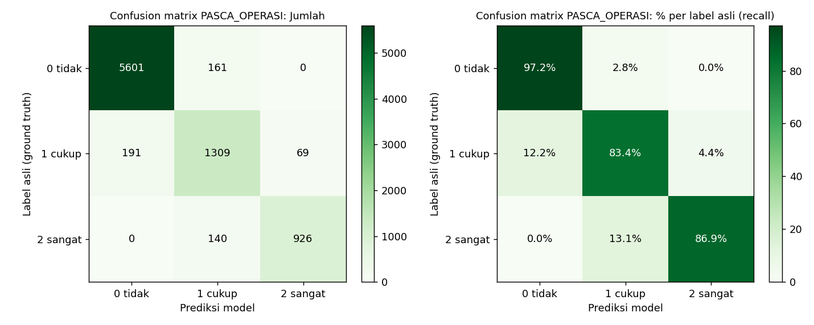
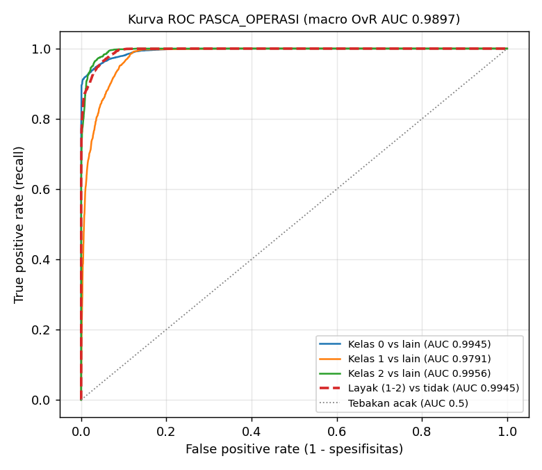

# Laporan Validasi Model PASCA_OPERASI

- Pemilik: **Raymond**
- Metode: Logistic Regression multinomial (label 0/1/2), metode dan konfigurasi sama dengan 3 kategori lain (config hash `7ec1c77b29e130d2`)
- Data: 560 profil latih (33583 pasangan), 140 profil uji baru (8397 pasangan); split per profil
- Tanggal laporan: 2026-11-03

## 1. Validasi AI (test set profil baru)

Model dievaluasi ulang dari artefak `pasca_operasi/model/recommender_PASCA_OPERASI.joblib` pada `pasca_operasi/data/test_data.csv`: 8397 pasangan (profil, sesi, makanan) dari 140 profil yang tidak pernah dilihat saat training. Ground truth = kolom `label` (0 tidak sesuai, 1 cukup sesuai, 2 sangat sesuai) dari rubrik pakar; prediksi = kelas dengan `predict_proba` tertinggi; ROC-AUC dihitung dari probabilitas.

Distribusi label test: 0 = 5762 (68.6%), 1 = 1569 (18.7%), 2 = 1066 (12.7%). Karena kelas tidak seimbang, accuracy dilengkapi balanced accuracy, metrik macro, dan ROC-AUC.

### 1.1 Ringkasan

| Metrik | Nilai | Arti |
|---|---|---|
| Accuracy | 0.9332 | 7836 dari 8397 pasangan diprediksi tepat |
| Balanced accuracy | 0.8917 | rata-rata recall 3 kelas (tidak bias ke kelas 0) |
| Precision (macro) | 0.9036 | rata-rata precision 3 kelas, bobot sama |
| Recall (macro) | 0.8917 | rata-rata recall 3 kelas, bobot sama |
| F1 (macro) | 0.8972 | rata-rata harmonik precision & recall per kelas |
| Precision / Recall / F1 (weighted) | 0.9336 / 0.9332 / 0.9332 | rata-rata berbobot jumlah data per kelas |
| ROC-AUC macro (one-vs-rest) | 0.9897 | kemampuan memisahkan tiap kelas dari kelas lain, 0.5 = acak, 1 = sempurna |
| ROC-AUC weighted (one-vs-rest) | 0.9918 | sama, dibobot jumlah data per kelas |
| ROC-AUC macro (one-vs-one) | 0.9824 | rata-rata AUC tiap pasang kelas (Hand & Till) |
| ROC-AUC layak (1-2) vs tidak (0) | 0.9945 | skor P(1) + P(2): menu boleh direkomendasikan atau tidak |
| ROC-AUC sangat sesuai (2) vs lainnya | 0.9956 | skor P(2): memilih makanan terbaik |
| Weighted kappa (kuadratik) | 0.9320 | kesepakatan dengan rubrik, salah 0 ke 2 dihukum lebih berat |
| Log loss | 0.1436 | kualitas probabilitas, makin kecil makin baik |
| NDCG@5 / NDCG@10 | 0.9899 / 0.9926 | kualitas urutan ranking menu per sesi |

### 1.2 Definisi metrik

Untuk satu kelas k (one-vs-rest): TP = label k diprediksi k, FP = label lain diprediksi k, FN = label k diprediksi kelas lain.

- Accuracy = jumlah prediksi benar / total data.
- Precision(k) = TP / (TP + FP): dari semua yang diprediksi k, berapa yang benar k.
- Recall(k) = TP / (TP + FN): dari semua yang benar k, berapa yang tertangkap model (sensitivitas).
- F1(k) = 2 x Precision x Recall / (Precision + Recall).
- Macro = rata-rata biasa 3 kelas; weighted = rata-rata berbobot jumlah data (support) tiap kelas.
- Confusion matrix: baris = label asli, kolom = prediksi; diagonal = prediksi benar.
- ROC-AUC: luas di bawah kurva TPR (recall) terhadap FPR untuk semua ambang probabilitas. Nilai = peluang model memberi skor lebih tinggi pada contoh positif acak daripada contoh negatif acak.
- Weighted kappa kuadratik = 1 - (sum w_ij O_ij) / (sum w_ij E_ij), dengan w_ij = (i - j)^2 / (3 - 1)^2, O = confusion matrix teramati, E = matriks yang diharapkan bila prediksi acak dengan distribusi kelas yang sama. 1 = sepakat sempurna, 0 = setara kebetulan.
- NDCG@k = DCG@k / IDCG@k per (profil, sesi), DCG@k = sum_{i=1..k} (2^label_i - 1) / log2(i + 1) untuk makanan yang diurutkan dengan skor model (P(1) + 2 x P(2)) / 2; IDCG@k = DCG urutan ideal menurut label. 1 = urutan sempurna.

### 1.3 Pemilihan metrik utama: weighted kappa dan NDCG

Label 0/1/2 bersifat ordinal (tidak sesuai < cukup sesuai < sangat sesuai) dan produk memakai model untuk mengurutkan makanan per sesi, sehingga metrik utama adalah weighted kappa dan NDCG@k. Accuracy, precision, recall, confusion matrix, dan ROC-AUC tetap dilaporkan sebagai metrik pendukung untuk analisis per kelas.

1. **Label ordinal.** Accuracy, precision, dan recall memperlakukan kelas sebagai kategori lepas (nominal): setiap salah prediksi dihitung sama. Memprediksi 2 untuk label 1 (meleset satu tingkat) dihukum sama dengan memprediksi 2 untuk label 0 (makanan tidak sesuai disebut sangat sesuai), padahal kesalahan kedua jauh lebih berbahaya. Weighted kappa kuadratik membobot kesalahan dengan kuadrat jarak tingkat (meleset 1 tingkat bobot 1, meleset 2 tingkat bobot 4). Pada PASCA_OPERASI, dari 561 prediksi salah, 561 meleset satu tingkat dan hanya 0 yang ekstrem (0 <-> 2); accuracy 0.9332 tidak membedakan keduanya, sedangkan weighted kappa 0.9320 memperhitungkannya.
2. **Koreksi kebetulan (kelas tidak seimbang).** 68.6% label test adalah 0. Model yang selalu menjawab 0 sudah mendapat accuracy 0.6862, tetapi kappa-nya 0 (tidak lebih baik dari kebetulan). Kappa mengukur kesepakatan di atas yang diharapkan secara kebetulan, sehingga tidak tertipu kelas mayoritas. Untuk alasan yang sama laporan ini menambahkan balanced accuracy (0.8917) serta precision dan recall macro.
3. **Produk memakai ranking.** Di produksi model tidak mengeluarkan satu kelas, tetapi mengurutkan kandidat makanan per sesi dengan skor (P(1) + 2 x P(2)) / 2, lalu penyusun menu mengambil yang teratas. NDCG@k menilai urutan itu: gain bertingkat (label 2 bernilai 3, label 1 bernilai 1, label 0 bernilai 0) dan diskon posisi (salah di peringkat 1 lebih berat dari peringkat 5). NDCG@5 model 0.9899 dibanding formula lama 0.7416 dan urutan acak 0.6149: bukti langsung bahwa model memperbaiki rekomendasi.

Metrik pendukung tetap diperlukan: accuracy, precision, dan recall adalah metrik standar yang mudah dijelaskan; per kelas metrik ini menjawab pertanyaan spesifik, misalnya recall kelas 0 (0.9721) = berapa banyak makanan tidak sesuai yang benar-benar ditolak (keamanan), dan precision kelas 2 (0.9307) = seberapa bisa dipercaya saat model menyebut 'sangat sesuai'. Confusion matrix menunjukkan letak kesalahan, dan ROC-AUC menilai pemisahan kelas dari probabilitas di semua ambang.

### 1.4 Precision, recall, F1 per kelas

| Kelas | Precision | Recall | F1 | ROC-AUC (OvR) | Jumlah (support) |
|---|---|---|---|---|---|
| 0 tidak sesuai | 0.9670 | 0.9721 | 0.9695 | 0.9945 | 5762 |
| 1 cukup sesuai | 0.8130 | 0.8343 | 0.8235 | 0.9791 | 1569 |
| 2 sangat sesuai | 0.9307 | 0.8687 | 0.8986 | 0.9956 | 1066 |
| **Macro avg** | 0.9036 | 0.8917 | 0.8972 | 0.9897 | 8397 |
| **Weighted avg** | 0.9336 | 0.9332 | 0.9332 | 0.9918 | 8397 |

- Kelas 0 (tidak sesuai): precision 0.9670 berarti makanan yang ditolak model memang hampir selalu tidak sesuai menurut rubrik; recall 0.9721 berarti hampir semua makanan tidak sesuai berhasil ditolak.
- Kelas 2 (sangat sesuai): precision 0.9307, recall 0.8687. Recall lebih rendah dari precision: model cenderung hati-hati, sebagian makanan terbaik dinilai 'cukup sesuai'.

### 1.5 Confusion matrix

Jumlah pasangan (baris = label asli, kolom = prediksi):

| Asli \ Prediksi | 0 tidak sesuai | 1 cukup sesuai | 2 sangat sesuai | Total |
|---|---|---|---|---|
| 0 tidak sesuai | 5601 | 161 | 0 | 5762 |
| 1 cukup sesuai | 191 | 1309 | 69 | 1569 |
| 2 sangat sesuai | 0 | 140 | 926 | 1066 |

Persen per baris (diagonal = recall kelas tersebut):

| Asli \ Prediksi | 0 tidak sesuai | 1 cukup sesuai | 2 sangat sesuai |
|---|---|---|---|
| 0 tidak sesuai | 97.21% | 2.79% | 0.00% |
| 1 cukup sesuai | 12.17% | 83.43% | 4.40% |
| 2 sangat sesuai | 0.00% | 13.13% | 86.87% |

- Benar: 7836 (93.32%). Salah ke kelas bersebelahan (0-1 atau 1-2): 561 (6.68%).
- Salah ekstrem (0 diprediksi 2 atau 2 diprediksi 0): 0 (0.00%). Kesalahan ekstrem paling berbahaya untuk rekomendasi; nilai kecil berarti model jarang membalik penilaian.

### 1.6 ROC-AUC

| Sudut pandang | Positif | Skor | ROC-AUC |
|---|---|---|---|
| Kelas 0 vs lainnya | label 0 | P(0) | 0.9945 |
| Kelas 1 vs lainnya | label 1 | P(1) | 0.9791 |
| Kelas 2 vs lainnya | label 2 | P(2) | 0.9956 |
| Macro one-vs-rest | - | - | 0.9897 |
| Weighted one-vs-rest | - | - | 0.9918 |
| Macro one-vs-one | - | - | 0.9824 |
| Layak vs tidak | label 1 atau 2 | P(1) + P(2) | 0.9945 |
| Sangat sesuai vs lainnya | label 2 | P(2) | 0.9956 |

- Kelas 1 (cukup sesuai) berada di tengah skala ordinal sehingga paling sulit dipisahkan; AUC-nya wajar paling rendah.
- AUC 'layak vs tidak' paling relevan untuk keamanan produk: seberapa baik model memisahkan makanan yang boleh direkomendasikan dari yang tidak, sebelum filter keamanan (alergi, pantangan, BLOKIR) diterapkan di produksi.

### 1.7 Validasi silang GroupKFold (5 lipatan, data latih)

Profil di lipatan validasi tidak pernah ada di lipatan latih. Simpangan baku kecil = performa stabil antar subset profil.

| Metrik | Rata-rata | Simpangan baku |
|---|---|---|
| accuracy | 0.9326 | 0.0038 |
| macro_f1 | 0.8987 | 0.0036 |
| weighted_kappa | 0.9353 | 0.0034 |
| ndcg@5 | 0.9872 | 0.0026 |

Precision, recall, dan ROC-AUC per lipatan ikut tercatat setelah model dilatih ulang (`python pasca_operasi/ai_models/latih_pasca_operasi.py`).

### 1.8 Generalisasi ke makanan baru

15% makanan hanya muncul di test (tidak pernah dilihat model saat training):

| Subset | Jumlah | Accuracy | Precision (macro) | Recall (macro) | F1 (macro) | ROC-AUC macro OvR |
|---|---|---|---|---|---|---|
| Seluruh test | 8397 | 0.9332 | 0.9036 | 0.8917 | 0.8972 | 0.9897 |
| Makanan baru | 1280 | 0.9078 | 0.8664 | 0.8567 | 0.8613 | 0.9832 |

## 2. Pembanding

| Metode | Accuracy | F1 (macro) | Kappa | NDCG@5 |
|---|---|---|---|---|
| Logistic Regression (model) | 0.9332 | 0.8972 | 0.9320 | 0.9899 |
| Gradient boosting (pembanding) | 0.9614 | 0.9385 | 0.9608 | 0.9960 |
| Formula lama | - | - | - | 0.7416 |
| Urutan acak | - | - | - | 0.6149 |

- Pasangan konflik yang tetap diberi label > 0 oleh model saja: 0.00% (di produksi dibuang dulu oleh filter keamanan)

## 3. Koefisien teratas (arah sangat sesuai vs tidak sesuai)

| Fitur | Bobot |
|---|---|
| any_conflict | -9.6186 |
| natrium_lewat_jauh | -7.8156 |
| gula_lewat_jauh | -7.0608 |
| n_block_kategori | -6.4302 |
| porsi_wajar | 5.5468 |
| lemak10_x_saluran_cerna | -4.338 |
| porsi_ideal | 3.9316 |
| protein_15 | 3.6608 |
| ft_protein__snack | -3.5766 |
| protein_pct_sesuai | 3.3201 |

## 4. Uji end-to-end (filter keamanan + model + penyusun menu, katalog Supabase)

| Skenario | Item | Kandidat lolos | Alergen | BLOKIR | Tekstur | Skor rata-rata | Latensi (ms) |
|---|---|---|---|---|---|---|---|
| Pasca Operasi Saluran Cerna (Lunak) | 11 | 14 | 0 | 0 | 0 | 75.7 | 43.8 |
| Pasca Operasi Ortopedi (Cair) | 1 | 1 | 0 | 0 | 0 | 3.5 | 40.1 |

**Pasca Operasi Saluran Cerna (Lunak)**: pagi: karbo: Organic Brown Rice, lauk: Edamame, buah/sayur: Banana; snack_pagi: sayur: Mustard Greens; siang: karbo: Oatmeal, lauk: Tilapia Fish, sayur: Sweet Potato; snack_sore: sayur: Broccoli; malam: karbo: Quinoa, lauk: Tofu, lauk: Lentils

**Pasca Operasi Ortopedi (Cair)**: pagi: susu/olahan: Low Fat Milk; snack_pagi: -; siang: -; snack_sore: -; malam: -

## 5. Catatan

Data sintetis dan label dari rubrik kategori (pasca_operasi/ai_models/rubrik.py). Angka di atas mengukur seberapa baik model meniru rubrik, bukan hasil uji klinis. Diperlukan gold set ahli gizi (minimal 300 pasangan) sebelum klaim klinis.

Keterbatasan data dan ground truth sintetis serta rencana pengembangannya dibahas di [laporan_validasi_ai.md](../../laporan_validasi_ai.md) bagian 7 dan 8.
